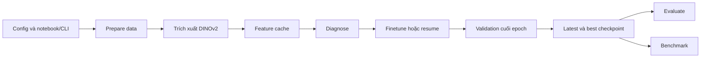
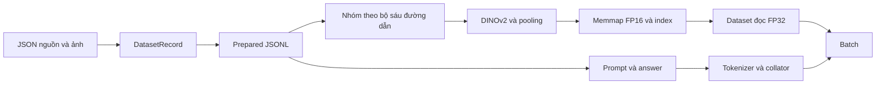
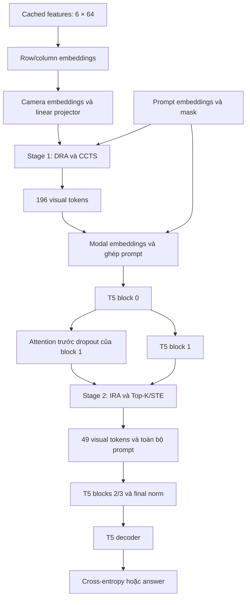

# Phân tích luồng repository huy-dinov2

> Cập nhật sau khảo sát: runtime hiện chỉ còn MVPruner. GPA/router/instruction-adapter và config baseline đã được xóa khỏi triển khai hiện tại; các đoạn bên dưới mô tả chúng là bản ghi lịch sử trước khi dọn code. Checkpoint MVPruner v2 cũ được nạp qua lớp tương thích hẹp; cache DINO giữ nguyên. Xem [báo cáo dọn runtime](mvpruner-only-cleanup.md) để biết thay đổi và kiểm chứng mới.

Ngày khảo sát: 2026-10-27. Báo cáo mô tả code tại thời điểm khảo sát; các đường dẫn và số dòng có thể thay đổi khi repository được cập nhật.

## 1. Mục đích và phạm vi xác minh

Dự án xây dựng mô hình hỏi–đáp bằng văn bản về cảnh giao thông từ sáu camera. Profile chính dùng **DINOv2-S → MVPruner hai giai đoạn → T5-Efficient-Mini**, ưu tiên giảm số visual tokens để giảm chi phí xử lý trong mô hình ngôn ngữ.

Báo cáo dựa trên việc đọc code, cấu hình, notebook, tài liệu và nội dung tests. Không cài dependency, tải dataset/model hoặc chạy training. Kiểm tra tĩnh đã parse thành công 63 file Python trong `src/`, `tests/`, `scripts/` và JSON của hai notebook. Đây là kiểm tra cú pháp, không chứng minh tính đúng đắn khi chạy.

Python được kiểm tra trong phiên thiếu `pytest`, `torch`, `transformers`, `numpy`, `yaml` và `huggingface_hub`, nên không chạy bộ test. Các mục nói về tests bên dưới mô tả điều tests kiểm tra, không phải kết quả pass của phiên này.

## 2. Bản đồ repository

| Thành phần | Vai trò |
|---|---|
| `src/efficient_vlm_ad/` | Triển khai hiện tại: CLI, data/cache, model, train, evaluate, benchmark |
| `configs/` | Profile DINOv2/MVPruner chính và baseline ViT/T5 |
| `notebooks/` | Debug và full finetune trên Kaggle |
| `scripts/` | Bootstrap Kaggle, kiểm tra tham số/weight tying, benchmark thành phần |
| `tests/` | Thuật toán, gradient, cache, checkpoint, CLI và notebook contracts |
| `em_vlm4ad/` | Mã tham chiếu upstream EM-VLM4AD |
| `docs/` | Kiến trúc, thuật toán, benchmark và nghiên cứu |
| `outputs/` | Artifact phát sinh khi chạy |

Profile đang dùng: [dinov2_t5_efficient_mini_kaggle_2gpu_mvpruner.yaml](../../configs/dinov2_t5_efficient_mini_kaggle_2gpu_mvpruner.yaml).

- Vision: `facebook/dinov2-small`, revision được cố định.
- Text: `google/t5-efficient-mini`, revision được cố định.
- Vision chạy trước để tạo feature cache; không tham gia training graph của finetune.
- Projector là linear học được `384 → 384`.
- Visual token budget: `384 → 196 → 49`.
- FP32; batch 16/process; accumulation 2; hai GPU; 10 finetune epochs.
- Notebook chạy trực tiếp `finetune`, không bắt buộc `align`.
- Dependency của profile MVPruner yêu cầu Transformers `4.46.3`; notebook cài binary tokenizers `0.20.4` trước.

## 3. Điểm khởi chạy và workflow

`python -m efficient_vlm_ad` đi qua `__main__.py` đến parser trong [cli.py](../../src/efficient_vlm_ad/cli.py) (`build_parser`, dòng 247). Các lệnh chính nhận `--config`; không có một profile tự động mặc định cho mọi lệnh.

| Lệnh | Hàm thực hiện | Đầu ra |
|---|---|---|
| `inspect-data` | `inspect_hf_dataset` | Thông tin nguồn và split candidates |
| `prepare-data` | `hf_data.prepare_data` | Prepared JSONL và manifest |
| `prepare-features` | `pipeline.prepare_features` | Memmap, index, cache manifest |
| `diagnose-train` | `diagnose_train` | Chẩn đoán khởi tạo, forward/backward, gradient |
| `train` | `train_stage` | Checkpoint, validation loss, progress logs |
| `verify-align-checkpoint` | `verify_align_checkpoint` | Báo cáo kiểm tra checkpoint align |
| `verify-resume-checkpoint` | `verify_resume_checkpoint` | Kiểm tra nạp và cập nhật tiếp |
| `evaluate` | `evaluate_checkpoint` | Predictions, metrics, generation diagnostics |
| `benchmark` | `benchmark_checkpoint` | Latency, throughput, prefill/FLOPs |
| `debug-sample` | `debug_sample` | Kiểm tra một mẫu |
| `monitor-progress` | CLI progress reader | Sự kiện tiến độ gần nhất |



### Notebook debug và full

| Thiết lập | Debug | Full |
|---|---|---|
| Prepared data | Tối đa 64 record/split | Toàn bộ split |
| Batch/process | 2 | 16 |
| Accumulation | 1 | 2 |
| Train | 20 batch, tương ứng 20 optimizer updates | 10 epoch |
| Workers | 0 | 2 |
| Generation | 64 tokens, 1 beam | 512 tokens, 3 beams |
| Evaluate/benchmark | 8 mẫu | Toàn bộ test / mặc định 200 mẫu |
| Output | Profile hậu tố `_debug` | Profile chính |
| Resume | Không sử dụng checkpoint repo đã khai báo trong luồng debug | Local latest trước, checkpoint HF sau |

Debug tạo YAML runtime riêng, không sửa config chính. Cả hai yêu cầu hai GPU và Accelerate `--mixed_precision no`.

Full notebook kiểm tra prepared data/cache, chạy diagnose, xác thực resume nếu có, rồi finetune. Cuối cùng ưu tiên best checkpoint, evaluate, benchmark và archive artifact. Nếu không có cache và không cấu hình cache repo, notebook chuẩn bị lại full raw data trước khi trích xuất features.

Nguồn: [debug notebook](../../notebooks/kaggle_debug_dinov2_mvpruner_finetune.ipynb), [full notebook](../../notebooks/kaggle_train_dinov2_mvpruner_finetune.ipynb), [bootstrap](../../scripts/kaggle_bootstrap.py) (`main`, dòng 11).

## 4. Dữ liệu từ nguồn đến batch

### 4.1. Record và prepared data

Nguồn cấu hình là `minhdang0901/drivelm-nuscenes-v1-0`. Code tìm JSON train/val/test có tên liên quan `frame` hoặc `multi_frame`; sử dụng split có sẵn, không tự chia ngẫu nhiên.

Parser hỗ trợ dictionary và cặp `[QA, camera_paths]`, chuẩn hóa thành:

```text
DatasetRecord
  question: str
  answer: str
  camera_paths: dict[str, str]
  sample_id: str
  eval_id: int | None
  split: str
```

Tên `CAM_FRONT`, `CAM_BACK`… được ánh xạ sang tên camera chuẩn. Thiếu câu hỏi, answer hoặc camera sẽ bị từ chối. Thứ tự camera đầu vào:

```text
Front, Front-Left, Front-Right, Back, Back-Left, Back-Right
```

`prepare-data` ghi `train.jsonl`, `val.jsonl`, `test.jsonl` và manifest chứa root ảnh, counts, subset, file split gốc. Counts full theo config:

| Split | Record |
|---|---:|
| Train | 341381 |
| Validation | 19785 |
| Test | 16817 |

Smoke giữ tối đa 64 record/split; khi tải từ HF, chỉ tải ảnh mà các record smoke tham chiếu. Full kiểm tra counts với cấu hình.

Nguồn: [hf_data.py](../../src/efficient_vlm_ad/hf_data.py): `DatasetRecord` dòng 27, parser dòng 70, `prepare_data` dòng 241.

### 4.2. Ảnh và feature cache

Ảnh được mở RGB, kiểm tra đường dẫn không thoát snapshot root, rồi qua processor DINOv2: resize cạnh ngắn 256, center crop 224×224, rescale và normalize. Wrapper kiểm tra processor khớp policy và đầu ra hữu hạn `[3,224,224]`.



Cache không có một row cho mỗi QA. `_record_key` ghép sáu đường dẫn theo tên camera được sắp xếp; QA cùng bộ ảnh dùng chung feature row. Thứ tự tạo key khác thứ tự camera tensor nhưng writer/reader dùng chung quy tắc key.

`prepare-features` dùng `torch.no_grad()`, tạo:

```text
cache/
  features.float16.memmap
  index.json
  manifest.json
```

Memmap có shape `[N,6,64,384]`, với `N` là số bộ ảnh duy nhất trong tập record được xử lý.

Manifest DINOv2 v2 ràng buộc model/revision, processor policy, pooling, geometry, camera order, storage/load dtype, hash prepared files và hash index. Do đó prepared files và cache tải từ máy khác phải tương thích chính xác; sửa manifest prepared cũng có thể làm cache bị từ chối.

Notebook kiểm tra thêm byte length, index và coverage. Nếu cần tạo cache mới, phải có ảnh gốc: JSONL chứa đường dẫn từ máy khác không đủ.

Nguồn: [vision.py](../../src/efficient_vlm_ad/modeling/vision.py): processor dòng 8, extractor dòng 33; [pipeline.py](../../src/efficient_vlm_ad/pipeline.py): key dòng 260, extraction dòng 268; [cache.py](../../src/efficient_vlm_ad/cache.py): manifest identity dòng 67.

### 4.3. Dataset và collator

`CachedVLMDataset` đọc FP16 memmap và chuyển features sang FP32. Record thiếu key cache bị lọc; nếu không còn record nào thì báo lỗi. Notebook full kiểm tra coverage chặt hơn cơ chế lọc của dataset.

Collator tạo prompt `Question: {question} Answer:`, tokenize prompt và answer, padding theo batch. Padding labels đổi thành `-100` để loss bỏ qua. Không truyền tùy chọn truncation hoặc max length trong collator.

Batch gồm `input_ids`, `attention_mask`, `visual_features`, `labels`, `answers`, `eval_ids`.

Nguồn: [pipeline.py](../../src/efficient_vlm_ad/pipeline.py): dataset dòng 350, collator dòng 418; [data.py](../../src/efficient_vlm_ad/data.py): prompt dòng 11.

## 5. Forward pass và tensor shapes

Ký hiệu: `B` là batch/process, `Lq` là chiều dài prompt có padding, `La` là chiều dài answer có padding.

| Bước | Shape |
|---|---|
| Sáu ảnh | `[B,6,3,224,224]` |
| DINOv2 last hidden state | `[B*6,257,384]` |
| Bỏ CLS, đổi thành lưới | `[B*6,384,16,16]` |
| Average pooling 2×2 | `[B,6,64,384]` |
| Spatial/camera embedding, flatten | `[B,384,384]` |
| Linear projector | `[B,384,384]` |
| Stage 1 | `[B,196,384]` |
| Ghép visual và prompt | `[B,196+Lq,384]` |
| T5 blocks 0 và 1 | `[B,196+Lq,384]` |
| Stage 2 và giữ prompt | `[B,49+Lq,384]` |
| T5 blocks 2 và 3 | `[B,49+Lq,384]` |
| Labels | `[B,La]` |
| Decoder logits khi train | `[B,La,vocab_size]` |



Factory chọn fusion theo config. Profile chính không có DynamicInstructionAdapter. GPA vẫn được khởi tạo trong VLM nhưng không dùng trong forward MVPruner và được freeze. Projector vẫn là `nn.Linear` học được dù input/output cùng 384 vì `type: linear`.

Nguồn: [factory.py](../../src/efficient_vlm_ad/modeling/factory.py): fusion dòng 208, VLM dòng 249; [vlm.py](../../src/efficient_vlm_ad/modeling/vlm.py): MVPruner encode dòng 77, spatial dòng 133, forward dòng 142; [multimodal.py](../../src/efficient_vlm_ad/modeling/multimodal.py): projector dòng 7.

## 6. MVPruner chi tiết

### 6.1. Stage 1: 384 → 196

DRA phân bổ ngân sách giữa sáu camera:

1. Chuẩn hóa visual vectors và tính cosine distance trong từng camera.
2. Loại diagonal; lấy nearest-neighbor distance của mỗi token.
3. Trung bình thành diversity của camera.
4. Chuẩn hóa `(s-max(s))/(max(s)-min(s)+1e-5)`, sau đó softmax.
5. Cấp ngân sách nguyên, tổng đúng 196; mỗi camera tối thiểu 1, tối đa 64.

Relevance:

```text
r(v) = clamp((1 + max cosine(v, q)) / 2, 0, 1)
```

`q` chạy qua các prompt tokens không bị mask, kể cả phần `Question:` và `Answer:`.

CCTS chọn trong từng camera: seed có relevance lớn nhất; các token tiếp theo tối đa hóa `minimum distance to selected set × relevance`. Running minimum được cập nhật sau mỗi lần chọn. Đầu ra sắp theo vị trí gốc.

Selection dùng tensor `detach`/`no_grad`. Values được gather từ tensor gốc, nên projector và embeddings vẫn học qua các tokens được giữ. Stage 1 không có gradient qua quyết định chọn index.

Nguồn: [mvpruner.py](../../src/efficient_vlm_ad/modeling/mvpruner.py): allocator dòng 23, CCTS dòng 72, stage 1 dòng 274.

### 6.2. Stage 2: 196 → 49

Sau block 0, code tính lại self-attention probabilities trước dropout của block 1. Relevance lấy vùng `question queries → visual keys`, trung bình theo heads và question queries hợp lệ. Sau đó block 1 xử lý hidden states.

IRA tính relevance trung bình mỗi camera, điều chỉnh trọng số theo tỷ lệ tokens hiện có, rồi cấp tổng đúng 49 dưới giới hạn capacity.

Trong train:

```text
logits = log(score) + beta * Gumbel noise
P_STE = P_hard - stop_gradient(P_soft) + P_soft
visual_out = P_STE @ visual_values
```

`P_soft` được tạo bằng slot-wise Relaxed Top-K. Beta giảm tuyến tính 0.2 → 0 theo optimizer updates; tau bằng 1. Evaluate/generate dùng beta 0 nên lựa chọn deterministic. Code vẫn tính soft slots và STE khi eval.

Sau pruning, giữ toàn bộ prompt tokens, gather attention mask và cả hai trục query/key của position bias, chạy blocks 2/3, final normalization và decoder. Split encoder yêu cầu đúng Transformers 4.46.3, encoder bốn blocks, split layer 2.

Token bị loại có thể nhận gradient qua score; không nhận gradient trực tiếp qua value chỉ từ phép chọn STE này. Trong toàn mạng, attention trước pruning vẫn có thể tạo đường gradient gián tiếp.

Nguồn: [t5_split_encoder.py](../../src/efficient_vlm_ad/modeling/t5_split_encoder.py): điều kiện dòng 38, attention dòng 98, relevance dòng 119; [mvpruner.py](../../src/efficient_vlm_ad/modeling/mvpruner.py): stage 2 dòng 346; [test STE](../../tests/test_mvpruner.py): dòng 100.

## 7. Một mẫu từ input đến output

Ví dụ theo schema test: question `Road?`, answer `yes`, sáu đường dẫn camera. Đây là minh họa từ cấu trúc test, không phải mẫu DriveLM thật được tải trong phiên.

1. Parser tạo record và cache key từ bộ ảnh.
2. Dataset trả `[6,64,384]` features, text và ID.
3. Collator tokenize `Question: Road? Answer:` cùng answer `yes`.
4. Model cộng spatial/camera embeddings và chiếu sang không gian T5.
5. Stage 1 giữ 196 visual tokens.
6. Hai T5 blocks kết hợp visual với prompt.
7. Stage 2 giữ 49 visual tokens; encoder xử lý tiếp.
8. Train: T5 dùng labels và teacher forcing để tính cross-entropy.
9. Evaluate: `generate()` sinh tokens, decode thành answer và chuẩn hóa khoảng trắng object tags.

Objective profile MVPruner chỉ là loss T5, không cộng diversity loss của nhánh router. Token `<` được thêm như token thường nếu thiếu để hỗ trợ object tags khi decode; code có logic khởi tạo/repair embedding và metadata tokenizer.

Nguồn: [tokenization.py](../../src/efficient_vlm_ad/tokenization.py): dòng 7; [vlm.py](../../src/efficient_vlm_ad/modeling/vlm.py): train dòng 142, generation dòng 295.

## 8. Training và tham số được cập nhật

| Thành phần | Align | Finetune |
|---|---|---|
| DINOv2 ở profile cache | Ngoài training graph | Ngoài training graph |
| T5 | Freeze | Train |
| Linear projector | Train | Train |
| Row/column embeddings | Train | Train |
| Camera/modal embeddings | Train | Train |
| GPA ở profile MVPruner | Freeze, không dùng | Freeze, không dùng |
| Beta/tau/budgets | State điều khiển | State điều khiển |

Freeze T5 ở align không ngăn gradient truyền xuyên phép toán T5 về projector.

Vòng train:

1. Tạo accelerator/model, áp dụng freeze policy.
2. Retie trọng số T5, kiểm tra storage dùng chung.
3. Nạp checkpoint nếu có.
4. Tạo AdamW với learning rate `1e-4`, weight decay `0.05`; dedupe tham số alias.
5. Tạo ExponentialLR gamma `0.9` và shuffled DataLoader.
6. Chuẩn bị model/optimizer/loader/scheduler qua Accelerate.
7. Forward, kiểm tra loss hữu hạn, backward.
8. Clip norm tối đa 1 và cập nhật theo accumulation; beta tăng step sau optimizer update.
9. Cuối epoch flush gradient còn dư, step scheduler, validation và lưu checkpoint.

Batch hiệu dụng cấu hình `16 × 2 × 2 = 64` cho nhóm accumulation đầy đủ. Validation chạy main process; loss là trung bình loss các batch. Best checkpoint dựa trên validation loss, không phải metric generation trên test.

Nguồn: [multimodal.py](../../src/efficient_vlm_ad/modeling/multimodal.py): freeze dòng 30; [pipeline.py](../../src/efficient_vlm_ad/pipeline.py): validation dòng 486, optimizer groups dòng 684, train dòng 768.

## 9. Checkpoint và resume

Checkpoint `.pt` lưu model, optimizer, scheduler, scaler slot, RNG và metadata. Metadata có stage, completed epochs, global step, best validation loss, generation/tokenizer settings, architecture signature và MVPruner schedule.

```text
checkpoints/
  finetune_latest.pt
  finetune_latest.pt.rng/
    manifest.json
    rank_00000.pt
    rank_00001.pt
  finetune_best.pt
  finetune_best.pt.rng/
    ...
  best_model.pt
```

Sidecar mỗi rank lưu RNG Python/NumPy/Torch/CUDA, sampler state nếu sampler hỗ trợ, epoch, batch cursor và optimizer step. World size khi restore phải khớp.

Resume cùng stage khôi phục training state. Chuyển align sang finetune chủ yếu nạp weights và bắt đầu trạng thái train stage mới. Full notebook ưu tiên local `finetune_latest.pt`, sau đó checkpoint HF và sidecars; kiểm tra đủ hai ranks trước khi train.

Checkpoint hiện lưu cuối epoch. Resume lấy `completed_epochs` làm điểm bắt đầu epoch tiếp theo; `batch_cursor` được lưu nhưng không được dùng để skip batch trong vòng train. Vì vậy chưa có cơ sở xem đây là resume tùy ý giữa epoch hoặc bảo đảm tái lập từng batch.

`verify-resume-checkpoint` strict-load, kiểm tra trainable policy, weight tying, optimizer storage, chạy forward/backward và một optimizer update trong bộ nhớ; không ghi đè checkpoint nguồn.

Architecture signature có `mvpruner.stage1_algorithm_version=2`; checkpoint stage 1 cũ bị từ chối thay vì âm thầm áp dụng thuật toán mới. Cache DINO có thể tái sử dụng nếu identity còn khớp.

Nguồn: [checkpointing.py](../../src/efficient_vlm_ad/checkpointing.py): signature dòng 16, rank RNG dòng 90, checkpoint dòng 165; [pipeline.py](../../src/efficient_vlm_ad/pipeline.py): resume/train dòng 768, sidecars dòng 1223, verify dòng 1575.

## 10. Evaluate, benchmark và log

### Evaluation

Evaluate dùng test split, gọi generation theo config, ghi:

```text
predictions.jsonl
generation_diagnostics.json
metrics.json
metrics_display.json
eval_progress.jsonl
```

Metrics thử tính BLEU-1…4, METEOR, ROUGE-L, CIDEr qua pycocoevalcap. Nếu import hoặc scorer phát sinh exception, code fallback sang exact match. Cần xem keys trong `metrics.json` trước khi so sánh kết quả. `metrics_display` nhân các caption metrics với 100.

Nguồn: [evaluation.py](../../src/efficient_vlm_ad/evaluation.py): metrics dòng 56; [pipeline.py](../../src/efficient_vlm_ad/pipeline.py): evaluate dòng 1751.

### Benchmark

Mặc định 200 test samples, batch 1, warmup tối đa 3 mẫu.

| Phép đo | Phạm vi |
|---|---|
| E2E | H2D của batch đã tạo, generation, chuyển kết quả về CPU và decode |
| Generation | Encoder/pruning và toàn bộ autoregressive generation |
| Prefill | Fusion/projector/pruning, encoder và decoder forward đầu tiên |
| Prefill FLOPs | Ước lượng major operators được PyTorch counter hỗ trợ |
| Peak CUDA memory | Peak generation trước instrumentation FLOPs |

E2E ở profile cache không bắt đầu từ ảnh thô. DataLoader/collation chạy trước timer; DINOv2 đã chạy offline. Prefill loại cả H2D, vision extraction, decode tiếp theo, beam/token selection và text postprocessing. FLOPs không bao phủ mọi phép toán như softmax, normalization, sorting/gather. Metadata nói rõ đây là T5 adaptation, không phải tái lập nguyên xi protocol của MVPruner.

Nguồn: [pipeline.py](../../src/efficient_vlm_ad/pipeline.py): benchmark dòng 1821; [prefill_benchmarking.py](../../src/efficient_vlm_ad/prefill_benchmarking.py): metadata dòng 24.

### Log và chẩn đoán

Heartbeat cho biết đang tạo accelerator/model, nạp checkpoint, đọc dataset hay chuẩn bị DataLoader. Debug có tensor statistics, numerics, gradient và token allocations. `debug/train_progress.jsonl` ghi train/validation/checkpoint events; evaluate và benchmark có progress JSONL riêng. Heartbeat gần nhất giúp khoanh vùng bước khởi tạo đang bị chậm hoặc treo.

## 11. Upstream, baseline và nhánh còn giữ

Baseline ViT/T5 có 49 tokens/camera. GPA tính một scalar weight/camera rồi cộng có trọng số thành 49 tokens. Legacy extractor chỉ dùng patch projection và positional embeddings của torchvision ViT, không chạy các ViT encoder blocks. DINOv2 hiện tại thực sự chạy backbone transformer; đây là khác biệt quan trọng khi diễn giải baseline.

Upstream `em_vlm4ad` dùng GPA với T5-Base hoặc T5-Large; nhánh Large cấu hình PEFT/LoRA. Bản hiện tại bổ sung config tập trung, cache, mask/label handling, distributed training và checkpoint verification.

Các nhánh có trong source nhưng không thuộc profile chính:

- Question-guided router: attention-pool question, FiLM visual features, scorer, Gumbel/STE và diversity loss tùy config.
- DynamicInstructionAdapter: visual tokens cross-attend text.
- RepViT extractor và chế độ train vision end-to-end.

Nguồn: [vision.py](../../src/efficient_vlm_ad/modeling/vision.py): legacy dòng 72; `gpa.py` (historical source; removed from runtime): dòng 7; `router.py` (historical source; removed from runtime): forward dòng 186; `adapters.py` (historical source; removed from runtime): dòng 7; [upstream model](../../em_vlm4ad/modules/multi_frame_model.py): dòng 31.

## 12. Phát hiện và điểm cần xác minh

| Phát hiện từ code | Ý nghĩa / trạng thái |
|---|---|
| `global_step` tăng mỗi batch | Không đồng nghĩa optimizer updates; debug trùng vì accumulation 1 |
| `val_every_steps`, `save_every_steps` được đọc nhưng không điều khiển train loop | Validation/save hiện ở cuối epoch |
| CLI dataset lọc record thiếu cache | Có thể dùng ít record hơn prepared split; notebook kiểm tra coverage chặt hơn |
| Target beta tính trước `accelerator.prepare()` | Cần xác minh schedule hai GPU sau DataLoader sharding |
| Train tự chia loss cho accumulation và cũng cấu hình accumulation cho Accelerate | Cần kiểm tra scaling runtime; chưa kết luận lỗi từ phiên này |
| Boundary accumulation dùng global step xuyên epoch, đồng thời flush cuối epoch | Cần test nhiều epoch khi số batch không chia hết accumulation |
| Cursor được lưu nhưng không được tiêu thụ để skip batch | Không coi là hỗ trợ arbitrary mid-epoch resume |
| `best_model.pt` là bản copy file best | Không thấy xuất RNG sidecars cho alias; dùng tên best/latest chính để resume |
| Caption scorer bắt mọi exception và fallback | Metrics có thể chỉ còn exact match |
| Eval vẫn tính soft slots ở stage 2 | Deterministic selection không có nghĩa bỏ toàn bộ overhead relaxation |

Tham chiếu chính: [pipeline.py](../../src/efficient_vlm_ad/pipeline.py), target steps dòng 890, scaling dòng 955, backward dòng 992, global step dòng 1018, checkpoint/sidecars dòng 1154–1253. Các nhận định về tác động distributed/scaling là câu hỏi cần kiểm chứng, không phải lỗi đã được xác nhận runtime.

Tài liệu [stage1-ccts-v2.md](../stage1-ccts-v2.md) phân biệt CCTS hiện tại với bản cũ: running minimum phải cập nhật đối với tập đã chọn; relevance vẫn là shifted max cosine và bounded allocation giữ tổng chính xác. Không nên suy ra implementation giống toàn bộ upstream MVPruner chỉ từ tên thuật toán.

## 13. Bằng chứng kiểm thử và giới hạn

| Nhóm tests | Hợp đồng được kiểm tra |
|---|---|
| Stage 1 | Oracle CCTS độc lập, allocation, tie/boundary, input không hữu hạn |
| MVPruner | Budget, canonical order, position bias, STE gradient, beta |
| Split T5 | Identity tương đương encoder gốc, padding, giữ text, checkpointing backward |
| DINO/cache | Geometry, v2 fingerprint, prepared/index identity, dtype |
| Checkpoint | Training state, tying, RNG từng rank, world size mismatch |
| Smoke CLI | Train/evaluate/benchmark với fake vision và T5 nhỏ |
| Notebook | Download/reuse cache, full counts, thiếu ảnh, resume/archive |

Bằng chứng tiêu biểu:

- [test_stage1_algorithm.py](../../tests/test_stage1_algorithm.py): oracle comparison dòng 45.
- [test_mvpruner.py](../../tests/test_mvpruner.py): STE gradient dòng 100.
- [test_t5_split_encoder.py](../../tests/test_t5_split_encoder.py): giữ text dòng 144, checkpointing dòng 176.
- [test_dinov2_cache.py](../../tests/test_dinov2_cache.py): manifest/dtype dòng 115.
- [test_checkpoint.py](../../tests/test_checkpoint.py): rank RNG dòng 185.
- [test_smoke_pipeline.py](../../tests/test_smoke_pipeline.py): MVPruner smoke dòng 296.
- [test_notebooks.py](../../tests/test_notebooks.py): reuse/missing-cache contracts từ dòng 130.

[stage1_v2_cpu_benchmark.json](../../outputs/stage1_v2_cpu_benchmark.json) là artifact đo CPU từ lần chạy trước. Nó không xác nhận hiệu năng GPU/Kaggle hoặc end-to-end của phiên khảo sát. Kết quả tests lịch sử được tài liệu ghi lại cũng không được coi là kết quả chạy mới.

Chưa xác minh động: chất lượng DriveLM thật, pretrained-model loss/gradient, accumulation/scaling với Accelerate, schedule sau sharding, resume tái lập hai GPU, latency và memory Kaggle.

## 14. Thứ tự đọc đề xuất

1. README → config chính → hai notebook để hiểu mục tiêu và workflow.
2. CLI → hf_data → cache/dataset/collator để hiểu đầu vào.
3. Factory → VLM → vision để hiểu cách lắp model.
4. MVPruner → split T5 → tests thuật toán để hiểu selection và gradient.
5. train_stage → checkpointing/verification để hiểu vòng đời training.
6. Evaluation → benchmarking/prefill để hiểu ý nghĩa số đo.
7. Upstream → GPA/router/adapter → tài liệu nghiên cứu để phân biệt các phương án.

Báo cáo không thay đổi API, interface, cấu hình hay implementation. Các điểm chưa xác minh được giữ riêng để tránh nhầm phân tích tĩnh với bằng chứng thực nghiệm.
